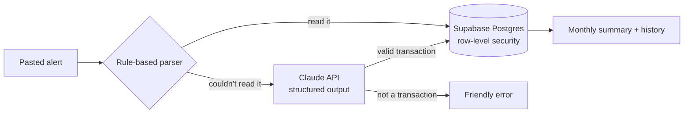

# Kudi AI

**Paste a Nigerian bank alert and Kudi AI turns it into a categorized transaction, then shows where your money went this month.**

<!-- Add after deploying: **Live demo:** https://your-app.vercel.app -->
<!-- Add a demo GIF here:  -->


## What it does

- Reads bank alerts in the layouts Nigerian banks use (SMS, email or app notifications): amount, debit or credit, balance, description and date.
- Sorts each transaction into a category such as Food & groceries, Transport, Airtime & data, Bills or Transfers.
- Shows money in, money out and spending by category for the current month, in Nigerian time.
- Keeps every user's data private with Supabase Auth and row-level security.

## How it works



1. **Rules first.** `src/lib/parse-alert.ts` reads common alert layouts with regular expressions. It's instant, free and covered by tests.
2. **AI only as a fallback.** When the rules can't find an amount or direction, the alert goes to Claude, which returns JSON that matches a Zod schema (`src/lib/llm-extract.ts`).
3. **Money is stored in kobo** as whole numbers, so totals never suffer from floating-point rounding.

## Decisions and trade-offs

- **Parser before AI.** Most alerts follow a handful of fixed layouts, so rules handle them at no cost and with no delay. The AI covers the long tail of unusual formats. This keeps API spend low and results predictable.
- **Structured outputs instead of free text.** The AI must answer in a fixed schema with a fixed category list, so the app never has to guess at its reply.
- **Abuse limit.** Each user gets at most 30 AI-read alerts per 24 hours, and each alert is capped at 2,000 characters, so a public demo can't run up the API bill.
- **Prompt-injection guard.** The alert is wrapped in tags and the model is told it's data, not instructions. The worst a malicious alert can do is mislabel one of the sender's own transactions.

## Tech stack

Next.js (App Router, Server Actions) · TypeScript · Tailwind CSS · Supabase (Postgres, Auth, row-level security) · Claude API · Zod · Vitest · GitHub Actions

## Run it locally

1. Create a free project at [supabase.com](https://supabase.com).
2. In the Supabase SQL Editor, run [`supabase/migrations/0001_transactions.sql`](supabase/migrations/0001_transactions.sql).
3. In Supabase, go to Authentication › URL Configuration and add `http://localhost:3000/auth/callback` to the redirect URLs.
4. Copy the environment file and fill in your keys:

   ```bash
   cp .env.example .env.local
   ```

5. Install and start:

   ```bash
   npm install
   npm run dev
   ```

6. Open http://localhost:3000, create an account, confirm your email, then press **Try a sample**.

## Tests

```bash
npm test
```

The parser tests cover several real-world alert layouts, the balance's CR/DR suffix, 12-hour times, month names and impossible dates.

## Deploy

Import the repo on [Vercel](https://vercel.com), add the three variables from `.env.example`, then add `https://<your-domain>/auth/callback` to Supabase's redirect URLs.

## Roadmap

- Edit or delete a transaction
- Monthly budgets with a warning when a category goes over
- Forward alert emails automatically instead of pasting them

## License

MIT
